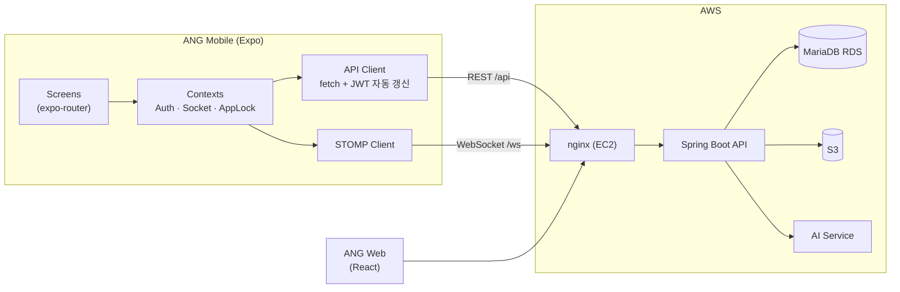

<div align="center">

# ANG Mobile

**사내 그룹웨어 ANG의 모바일 앱 (전자결재 · 실시간 채팅 · 메일 · AI 비서)**

웹 포털(React + Spring Boot)과 **같은 백엔드 API를 쓰는** 크로스플랫폼 앱입니다.<br/>
코드 하나로 Android, iOS, Web을 모두 지원합니다.


</div>

<!-- 스크린샷: assets/screenshots/ 에 이미지를 넣고 경로를 바꿔주세요 -->
<!--
| 대시보드 | 전자결재 | 채팅 | AI 비서 |
|:---:|:---:|:---:|:---:|
|  |  |  |  |
-->

## 📌 프로젝트 소개

| 항목 | 내용 |
|---|---|
| 종류 | 2026 캡스톤 디자인 (8조, 팀 프로젝트) |
| 기간 | 2026.09 ~ 진행 중 |
| 목표 | 사무실 밖에서도 결재, 메시지, 메일을 처리할 수 있는 모바일 그룹웨어 |
| 플랫폼 | Android / iOS / Web (Expo, 코드 하나로 빌드) |

ANG는 전자결재, 사내 메신저, 메일, 문서함, 일정을 한곳에서 쓰는 사내 그룹웨어입니다.
이 레포는 그중 **모바일 클라이언트**입니다. 웹 버전과 DB(MariaDB RDS), S3, AI 서비스를 그대로 공유하고, 화면은 모바일에 맞게 새로 설계했습니다.

## ✨ 주요 기능

| 기능 | 설명 |
|---|---|
| 🏠 **대시보드** | 결재 대기 건수, 주간 일정, 공지, 받은 메일, 알림을 한 화면에서 요약 |
| ✅ **전자결재** | 결재 문서 목록과 상세 조회, 승인/반려, 댓글 |
| 💬 **실시간 채팅** | STOMP WebSocket 기반 1:1·그룹 채팅, 파일 전송, 대화방 초대 |
| ✉️ **메일** | 받은/보낸 메일, 작성, 첨부파일 업로드·다운로드 |
| 🔔 **실시간 알림** | 개인 큐(`/user/queue/notification`) 구독으로 알림 즉시 수신 |
| 🤖 **AI 비서** | "오늘 일정 알려줘", "결재 대기 문서 있어?" 같은 자연어 질의 → 일정·메일·결재 결과 카드로 응답 |
| 📁 **문서함 / 공지 / 캘린더** | 내 문서·부서 문서·즐겨찾기, 공지사항, 일정 조회 |
| 🔐 **생체인증 잠금** | 지문/Face ID로 앱 잠금, 백그라운드 5분 경과 시 자동 잠금 |

## 🛠 기술 스택

| 분류 | 기술 |
|---|---|
| Framework | Expo SDK 57, React Native 0.86, React 19 |
| Language | TypeScript |
| Routing | expo-router (파일 기반 라우팅, 탭 + 스택) |
| 실시간 통신 | @stomp/stompjs (SockJS raw WebSocket 엔드포인트에 연결) |
| 인증 / 보안 | JWT (Access + Refresh), expo-secure-store, expo-local-authentication |
| 파일 | expo-document-picker, expo-file-system, expo-intent-launcher |
| 상태 관리 | React Context (Auth / Socket / AppLock) |
| Backend (공유) | Spring Boot, MariaDB (AWS RDS), AWS S3, EC2 + nginx |

## 🏗 아키텍처



웹과 앱이 **같은 백엔드를 공유**하기 때문에, 백엔드 응답 형식(`ApiResponse<T>`, `Page<T>` 등)을 정규화하는 공통 계층(`src/lib/api.ts`)을 두어 화면 코드가 응답 래핑 형태에 영향받지 않도록 했습니다.

## 🔥 기술적 고민과 해결

### 1. 동시에 여러 요청이 401을 받을 때 토큰 갱신이 중복되는 문제
- **문제:** 대시보드처럼 API 5~6개를 한꺼번에 호출하는 화면에서 액세스 토큰이 만료되면, 모든 요청이 각자 `/auth/refresh`를 호출했습니다. 그러다 서로의 Refresh Token을 무효화하면서 로그아웃되는 현상이 생겼습니다.
- **해결:** 갱신 중인 Promise를 모듈 단위로 하나만 들고 있다가, 동시에 들어온 요청들이 **같은 Promise를 기다리게** 했습니다(single-flight). 갱신이 끝나면 원래 요청을 한 번만 재시도하고, 실패하면 세션을 정리한 뒤 로그인 화면으로 보냅니다.
- 📄 `src/lib/api.ts` → `refreshAccessToken()`, `request()`

### 2. WebSocket 연결에는 "401 → 재시도"가 통하지 않는 문제
- **문제:** REST는 401을 받으면 갱신 후 재시도하면 되지만, STOMP `CONNECT` 프레임은 만료된 토큰을 보내면 거부만 당합니다. 이 때문에 재연결 시도가 무한히 실패했습니다.
- **해결:** `beforeConnect` 훅에서 JWT의 `exp`를 직접 디코딩해 **만료 30초 전이면 미리 갱신**한 뒤 연결합니다. 서버가 `Unauthorized`로 거부하면 다음 재연결 때는 무조건 갱신하도록 플래그를 둡니다.
- 📄 `src/contexts/socket.tsx`, `src/lib/api.ts` → `ensureFreshToken()`

### 3. 화면 이동 시 채팅 구독이 끊기거나 중복되는 문제
- **문제:** 채팅방 화면마다 소켓을 따로 열면 연결이 여러 개 생기고, 재연결 후에는 구독이 사라졌습니다.
- **해결:** STOMP 연결을 **앱 전역 Provider 하나로** 옮기고, 방별 리스너를 `Map<roomId, Set<listener>>`로 관리했습니다. 재연결되면 리스너가 남아 있는 방만 자동으로 다시 구독하고, 마지막 리스너가 빠지면 구독을 해제합니다.

### 4. 웹 빌드에서 CORS와 WebSocket 403
- **문제:** 같은 코드를 브라우저에서 실행하자, 배포 서버가 다른 Origin의 요청에 CORS 헤더를 주지 않았고 WebSocket 핸드셰이크도 403으로 거부했습니다.
- **해결:** 웹에서는 같은 출처의 `/api`를 호출하게 바꾸고, 개발 환경에서는 **Metro 개발 서버에 프록시 미들웨어**를 붙였습니다. Metro는 `/hot` 이외의 HTTP `upgrade` 요청을 끊어버리기 때문에, 기존 upgrade 리스너를 감싸서 `/api/`로 시작하는 요청만 백엔드로 터널링하도록 했습니다. 배포 환경에서는 nginx가 같은 역할을 합니다.
- 📄 `metro.config.js`, `src/lib/config.ts`

### 5. 플랫폼별로 다른 저장소와 파일 처리
- 토큰은 네이티브에서 **Keychain/Keystore(SecureStore)**, 웹에서 localStorage에 저장하도록 `storage` 추상화로 감쌌습니다.
- 첨부파일 업로드는 네이티브의 `{uri, name, type}` 객체와 웹의 `File` 객체를 하나의 `appendFile()`로 통일했습니다. 다운로드한 HWP, Office 문서는 Android Intent로 외부 앱에서 엽니다.

### 6. 생체인증 앱 잠금 UX
- 로그인 직후 한 번만 사용 여부를 묻고, 켤 때도 **본인 인증에 성공해야 설정이 저장**되게 했습니다.
- 파일 선택기나 뷰어를 잠깐 다녀올 때마다 잠기면 불편하기 때문에, **백그라운드에 5분 이상** 머물렀을 때만 잠급니다.
- 잠금 설정은 세션 키와 분리해 두어 로그아웃해도 유지됩니다.

## 👤 담당 역할

<!-- 실제 역할에 맞게 수정해주세요 -->
- 앱 전체 구조 설계: 탭/스택 라우팅, 공통 UI 컴포넌트, 디자인 토큰
- 인증 흐름(JWT 저장·복원·자동 갱신)과 API 클라이언트 구현
- 대시보드, 전자결재, 채팅, 메일, 문서함, 공지, 캘린더, AI 비서 화면 구현
- STOMP 전역 소켓 Provider 구현
- 웹 빌드 대응: 알림/확인 다이얼로그, Metro WebSocket 프록시

## 📂 폴더 구조

```
src/
├── app/                 # expo-router 화면 (파일 = 라우트)
│   ├── (tabs)/          # 하단 탭: 홈 · 결재 · 채팅 · 메일 · 더보기
│   ├── approval/        # 결재 상세
│   ├── chat/            # 채팅방 · 새 채팅 · 초대 · 정보
│   ├── mail/            # 메일 상세 · 작성
│   ├── documents/       # 문서함
│   ├── notices/         # 공지사항
│   ├── assistant.tsx    # AI 비서
│   ├── calendar.tsx
│   └── login.tsx
├── api/                 # 도메인별 API 함수 (approval, chat, mail, misc)
├── contexts/            # Auth · Socket(STOMP) · AppLock(생체인증)
├── lib/                 # API 클라이언트, 저장소, 파일, 생체인증, 포맷 유틸
├── components/          # 공통 UI, 잠금 화면, 사용자 검색
└── constants/           # 디자인 토큰 (웹 Soft UI 값 이식)
```

## 🚀 실행 방법

```bash
npm install
npx expo start        # Expo Go 또는 개발 빌드에서 QR 스캔
npm run web           # 브라우저 실행 (Metro 프록시 사용)
```

`.env`에 백엔드 주소를 설정한 뒤 `npx expo start -c`로 재시작합니다.

```env
EXPO_PUBLIC_API_URL=http://<서버 주소>:5500/api
```

| 환경 | 값 |
|------|-----|
| 배포 서버 (nginx 프록시) | `http://<EC2-IP>:5500/api` |
| 로컬 백엔드 | `http://<PC의 LAN IP>:9090/api` (기기에서 `localhost`는 기기 자기 자신을 가리킴) |

> 생체인증, 파일 열기 같은 네이티브 기능은 Expo Go가 아니라 개발 빌드(`npm run android` / `npm run ios`)에서 확인해야 합니다.

## 🔗 관련 레포

- [ANG-Capstone](https://github.com/sunghyeon0073/ANG-Capstone): 웹 포털 및 Spring Boot 백엔드
